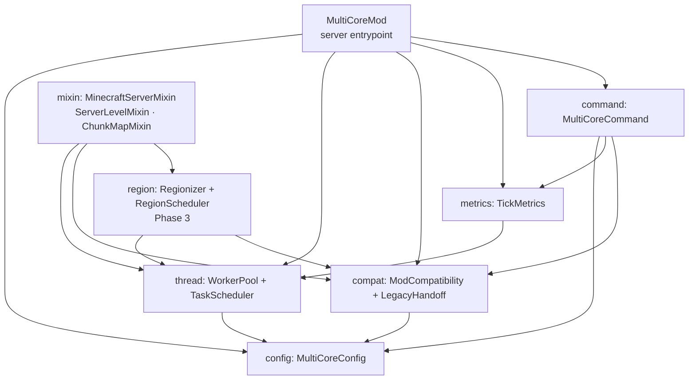

# ARCHITECTURE — Minecraft MultiCore Mod

> How the system is organized **today** (not how we would like it to be). Update in the same commit that changes the structure.
> If this document contradicts the code, the code wins — fix the document.

## Overview

The mod is a **server-side Fabric mod**. A single entrypoint boots it, loads the configuration once,
then installs:

1. a **worker pool** + **scheduler** that run offloaded work off the main thread and merge results
   back on the main thread (Phase 1);
2. a **compatibility layer** that classifies mods as *legacy* or *thread-safe* and hands legacy
   callbacks back to the main thread (Phase 2);
3. a **region scheduler** that replaces the vanilla tick fan-out with a parallel, owned-by-region
   execution (Phase 3);
4. a **command** and a **Mod Menu screen** for observability and configuration.



## Folder structure

```
src/main/java/com/strefiz/multicore/
  MultiCoreMod.java              # ModInitializer entrypoint (wires everything; runs on dedicated + integrated)
  config/
    MultiCoreConfig.java         # JSON config: workerThreads, mode, lists, debug
    ConfigMode.java              # SAFE | AGGRESSIVE
  thread/
    WorkerPool.java              # named fixed thread pool; start/stop
    TaskScheduler.java           # submit work, merge results on the main thread
  metrics/
    TickMetrics.java             # MSPT + per-thread timers, lock-free
  command/
    MultiCoreCommand.java        # /multicore subcommands
  compat/
    ModCompatibility.java        # classify mods from fabric.mod.json
    ModClassification.java       # LEGACY | COMPATIBLE
    LegacyHandoff.java           # queue legacy callbacks to the main thread
    ModMenuIntegration.java      # ModMenuApi (optional)
  region/                        # Phase 3
    Region.java
    RegionState.java
    Regionizer.java
    RegionScheduler.java
  mixin/
    MinecraftServerMixin.java
    ServerLevelMixin.java
src/main/resources/
  fabric.mod.json
  multicore.mixins.json
  assets/multicore/lang/{en_us,pt_pt}.json
src/test/java/...                # mirrors src/main
```

## Modules and responsibilities

| Module | Responsibility | Depends on | Notes |
|--------|----------------|------------|-------|
| `MultiCoreMod` | entrypoint; lifecycle; wiring | all | `DedicatedServerModInitializer` |
| `config` | parse/validate/persist config; one immutable snapshot applied at start | — | D-006, D-008 |
| `thread` | worker pool + offload/merge scheduler | `config` | never the common pool |
| `metrics` | tick and per-thread timing | `thread` | lock-free |
| `command` | `/multicore` | `config`, `metrics`, `compat` | |
| `compat` | mod classification + legacy hand-off + Mod Menu | `config` | D-005, D-007 |
| `region` | regionised tick (Phase 3) | `thread`, `compat` | Folia-style |
| `mixin` | vanilla hooks | `thread`, `compat`, `region` | thin; logic lives in modules |

**Dependency rule:** `region/mixin → compat/thread → config`; `config` imports nothing internal;
`compat` and `region` never import `command` or `metrics`. Cycles are forbidden.

Catalogue of reusable functions/components: `docs/MODULES.md`. Each module has its own `README.md`.

## Main flows

1. **Boot:** `onInitialize()` → register `/multicore` and the server lifecycle/tick events. The
   common `main` entrypoint is used so the mod also runs on an **integrated server** (singleplayer/
   LAN); on a client without a server the events simply never fire.
2. **Server start:** `SERVER_STARTING` → apply the config snapshot; `SERVER_STARTED` → begin metrics.
3. **Tick (Phase 1):** `START_SERVER_TICK` → start measuring, submit the registered offloads →
   `START_LEVEL_TICK` → vanilla tick → `END_SERVER_TICK` → `drainToMain()` (barrier + ordered
   merges) → stop measuring.
4. **Tick (Phase 3):** `tickChildren` mixin → regionizer assigns regions → scheduler runs regions on
   workers → barrier → legacy callbacks on the main thread → `END_SERVER_TICK`.
5. **Shutdown:** `SERVER_STOPPING` → stop offloads → `SERVER_STOPPED` → `WorkerPool.stop()`.

## Data and persistence

- One JSON file: `config/multicore.json`, loaded lazily, written on change by the Mod Menu screen.
- Config is an immutable snapshot; it is read once at `SERVER_STARTING` (D-008).
- No database, no world files written by the mod itself.

## External integrations

| Service/API | What for | Configuration (variables) | Failure → behavior |
|-------------|----------|--------------------------|------------------------|
| Fabric Loader | mod discovery + metadata | — | classification falls back to LEGACY |
| Fabric API events | tick/lifecycle hooks | — | event missing → features degrade, log warn |
| Mod Menu (optional) | config screen | `suggests.modmenu` | absent → screen unavailable, no crash |
| Brigadier | `/multicore` command | — | registration failure → log error |

## Relevant decisions

See `DECISIONS.md`: D-003 (server-first), D-004 (stack), D-005 (opt-in compatibility), D-006
(threads not cores), D-007 (Mod Menu), D-008 (config at start), D-009 (SAFE default), D-010
(additive).

## Known limitations and technical debt

- Mixin-based legacy mods are not protected by SAFE mode (see `docs/RESEARCH.md` §7.3).
- The exact body of `MinecraftServer.tickChildren` in 26.3 is still to be confirmed (spike S2).
- No CPU affinity yet (M4).
- No client support yet (M5).
