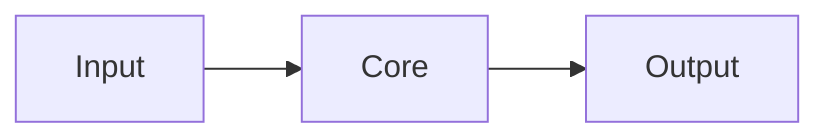

# ARCHITECTURE — Minecraft MultiCore Mod

> How the system is organized **today** (not how we would like it to be). Update in the same commit that changes the structure.
> If this document contradicts the code, the code wins — fix the document.

## Overview

<!-- One paragraph + simple diagram (ASCII or Mermaid). -->
_To be filled in with `/bootstrap`._



## Folder structure

```
src/
  ...
```

## Modules and responsibilities

| Module | Responsibility | Depends on | Notes |
|--------|----------------|------------|-------|
| _to be filled in_ | | | |

**Dependency rule:** _e.g.: `ui → app → domain`; `domain` imports nothing from outside._

Catalogue of reusable functions/components: `docs/MODULES.md`. Each module has its own `README.md`.

## Main flows

1. _e.g.: User does X → module A validates → module B persists → response_

## Data and persistence

_Core models, where and how they are stored, migrations._

## External integrations

| Service/API | What for | Configuration (variables) | Failure → behavior |
|-------------|----------|--------------------------|------------------------|

## Relevant decisions

See `DECISIONS.md` (reference D-NNN here).

## Known limitations and technical debt

_Short and honest list._
